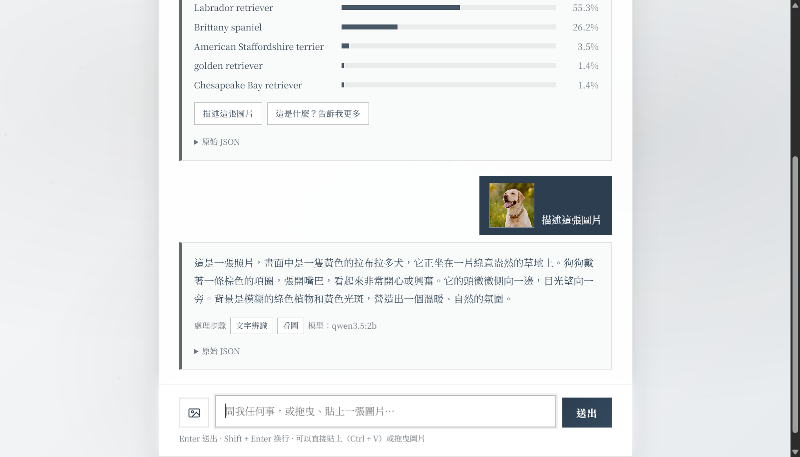
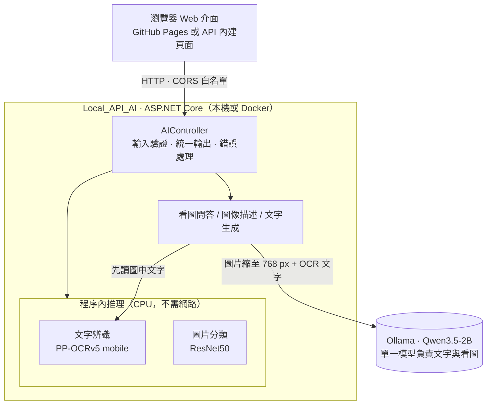
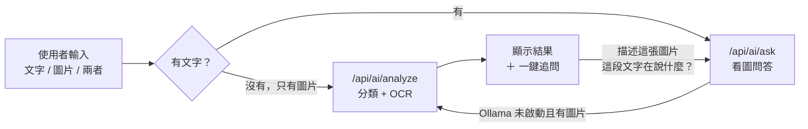
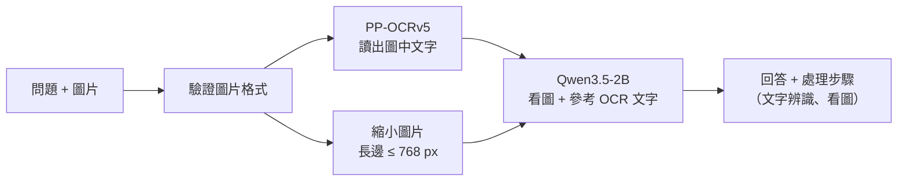
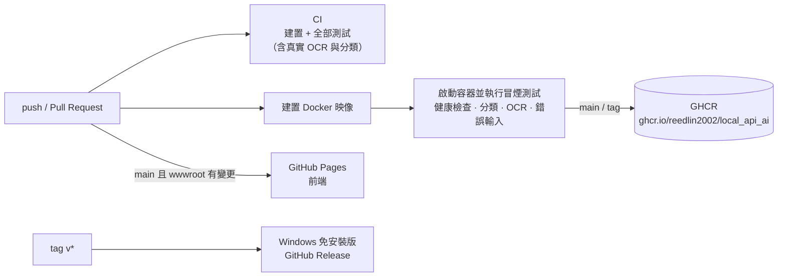

# Local_API_AI

### 本機部署的多模態 AI 推理 API

[](https://github.com/reedlin2002/Local_API_AI/actions/workflows/ci.yml)
[](https://github.com/reedlin2002/Local_API_AI/actions/workflows/container.yml)
[](https://reedlin2002.github.io/Local_API_AI/)

Local_API_AI 是一套在自己電腦上執行的 AI 推理服務，把圖片分類、文字辨識（OCR）、看圖問答與文字生成整合成同一組 REST API。所有推理都在本機完成，資料不會上傳到任何雲端服務。

> **線上展示**：[開啟 Web Demo](https://reedlin2002.github.io/Local_API_AI/)
> 介面放在 GitHub Pages，AI 運算在你本機的 API 上執行。開啟頁面前請先用 Docker 啟動 API（見[快速開始](#快速開始)）。

> **專案定位**
> 以小型開源模型（Qwen3.5-2B、PP-OCRv5、ResNet50）為核心，驗證一般筆電（4 GB 顯示卡）也能流暢執行的本機多模態路線。模型選擇都依實測決定，見[模型選擇與硬體考量](#模型選擇與硬體考量)。



---

## 目錄

- [核心價值](#核心價值)
- [功能總覽](#功能總覽)
- [系統架構](#系統架構)
- [流程架構圖](#流程架構圖)
- [技術棧](#技術棧)
- [模型與方法](#模型與方法)
- [模型選擇與硬體考量](#模型選擇與硬體考量)
- [API 入口](#api-入口)
- [效能與品質改善](#效能與品質改善)
- [CI/CD](#cicd)
- [快速開始](#快速開始)
- [目前限制](#目前限制)
- [未來展望](#未來展望)
- [專案結構](#專案結構)

---

## 核心價值

- **不用先選功能**：只有一個輸入框。丟圖片就自動分析、打字就回答、圖片加問題就看圖回答，系統自己決定該用哪些模型。
- **先讀字、再看圖**：圖片問題會先用專門的 OCR 模型精準讀出圖中文字，再把圖片和文字一起交給多模態模型。小模型自己讀字容易猜錯，OCR 模型幾乎不會。
- **筆電就跑得動**：一個 2B 的多模態模型同時負責文字與看圖，4 GB 顯存放得下 90%；看圖問答約 1 秒回完，不用在多個模型之間來回載入。
- **資料不離開本機**：影像與文字只在本機處理，適合內部文件、敏感圖片與離線環境。
- **沒有 LLM 也能用**：圖片分類與 OCR 在 API 程序內執行，不需要 Ollama；Ollama 沒啟動時，前端會改顯示本機分析結果。
- **預設安全**：CORS 只允許指定網站、錯誤訊息不帶堆疊資訊、不記錄使用者的 prompt 與模型輸出、限制上傳大小。
- **自動化交付**：每次 push 都會跑測試、建置並實際啟動 Docker 映像做冒煙測試，通過後才發佈。

## 功能總覽

| 功能 | 說明 |
| --- | --- |
| 單一輸入、自動分流 | 文字、圖片或兩者一起送出，前端自動決定要分析還是回答；結果下方提供一鍵追問 |
| 看圖問答 | 附圖提問時，OCR 先讀字，Qwen3.5 看圖並參考 OCR 結果回答，回應中列出處理步驟 |
| 圖片分析 | 分類與 OCR 平行執行、一次回傳，不需要 Ollama；圖中有文字時優先顯示文字 |
| 文字辨識 OCR | PP-OCRv5，支援繁體中文、簡體中文、英文與日文 |
| 圖片分類 | ResNet50 辨識圖片主體，回傳前 5 名 ImageNet 類別與機率 |
| 圖像描述 | 多模態模型直接看圖描述，可自訂指示（例如指定用中文） |
| 文字生成 | 本機 LLM 問答與創作 |
| 批次分類 / 多格式輸出 | 一次上傳多張圖片；每個端點都能回傳 JSON 或純文字 |

---

## 系統架構



### 前端

`wwwroot/index.html` 是純靜態頁面，介面只有一個輸入框：可以打字、按按鈕附加圖片、直接拖曳或貼上（Ctrl + V）圖片。使用者不需要知道背後有哪些模型，頁面會依輸入內容自動呼叫對應的 API（見[前端自動分流](#前端自動分流)）。

同一份檔案有兩種用法：由 API 本身提供（`http://localhost:5136`），或部署在 GitHub Pages 上，再連回使用者本機的 API。頁面會自動偵測 API 是否在線，未連線時每 5 秒自動重試。

### 後端與 AI 推理

ASP.NET Core（.NET 10）提供 REST API，負責：

- 驗證上傳檔案（格式、大小）並統一錯誤回應格式（RFC 7807）
- OCR 與圖片分類直接在程序內執行（ONNX Runtime），模型只載入一次
- 看圖問答、圖像描述與文字生成透過 Ollama 呼叫本機的 Qwen3.5；API 啟動時就在背景預先載入模型
- 將 Ollama 的各種失敗（未啟動、缺模型、逾時）轉成明確的狀態碼與提示

### 外部服務

唯一的外部依賴是本機的 [Ollama](https://ollama.com)，只有看圖問答、圖像描述與文字生成需要它。

---

## 流程架構圖

### 前端自動分流



附加的圖片會保留在輸入框，接著追問同一張圖片時不用重新上傳；按 × 即可移除。

### 看圖問答流程



OCR 與縮圖同時進行。沒有附圖時，問題直接交給同一個模型回答。

### 錯誤處理

| 情境 | 狀態碼 | 回應 |
| --- | --- | --- |
| 上傳的不是圖片 | `400` | 說明支援的格式 |
| 缺少必要欄位或未知的 model | `400` | 指出缺少哪個欄位 |
| Ollama 沒有啟動 / 缺少模型 | `503` | 提示執行 `ollama serve` 或 `ollama pull <模型>` |
| 模型在時限內未回應 | `504` | 可調整 `Ollama:TimeoutSeconds` |
| 未預期錯誤 | `500` | 只回傳通用訊息，細節留在伺服器日誌 |

---

## 技術棧

| 分層 | 技術 |
| --- | --- |
| API | ASP.NET Core（.NET 10）、Swagger / OpenAPI、ProblemDetails |
| 影像處理 | SkiaSharp（解碼、EXIF 轉正、縮放裁切） |
| OCR | PP-OCRv5 mobile、RapidOcrNet、ONNX Runtime |
| 圖片分類 | ResNet50 v2、ONNX Runtime |
| 多模態 LLM | Ollama、Qwen3.5-2B（非思考模式） |
| 前端 | HTML、CSS、JavaScript（無框架） |
| 測試 | xUnit、WebApplicationFactory（真實 OCR / 分類整合測試 + 假 Ollama 單元測試） |
| 部署 | Docker（GHCR）、GitHub Pages、Windows 免安裝版（GitHub Releases） |
| CI/CD | GitHub Actions |

---

## 模型與方法

| 模組 | 模型／方法 | 主要用途 |
| --- | --- | --- |
| 文字辨識 | PP-OCRv5 mobile（偵測 + 中文辨識，約 22 MB，關閉方向分類以降低延遲） | 精準讀出圖中文字，提供給模型作為依據 |
| 看圖問答 / 描述 / 文字 | Qwen3.5-2B（Ollama，非思考模式，採 model card 建議的取樣參數） | 理解圖片內容並以使用者的語言回答 |
| 送圖前處理 | 長邊縮至 768 px（PNG 保持 PNG 以維持文字清晰） | 圖片的 token 數與像素數成正比，縮圖可大幅降低延遲 |
| 圖片分類 | ResNet50 v2 + ImageNet 正規化 + softmax | 不需要 Ollama 的快速離線分類 |

---

## 模型選擇與硬體考量

開發機為 GTX 1650 Ti（4 GB 顯存）+ i7-10750H，以下皆為該機器上的實測。

### LLM：模型要「放得進顯存」

| 模型 | 載入大小 | 在顯存的比例 | 文字生成速度 | 能看圖 |
| --- | --- | --- | --- | --- |
| mistral 7B（舊預設） | 4.8 GB | 54% | 8 tok/s | 否 |
| phi3 3.8B | 3.2 GB | 81% | 13 tok/s | 否 |
| qwen3.5:0.8b | 0.6 GB | 100% | 43 tok/s | 是，但常識容易捏造 |
| **qwen3.5:2b（預設）** | 2.4 GB | **90%** | **32 tok/s** | 是 |
| qwen3.5:4b | 3.2 GB | 67% | 12 tok/s | 是，回答品質最好 |

速度主要取決於模型有多少比例放得進顯存：4B 有三分之一落到 CPU，速度只剩 2B 的三分之一。顯存更大的電腦可改用 4B（設定 `Ollama:Model`）。依 [Qwen3.5-2B model card](https://huggingface.co/Qwen/Qwen3.5-2B)，2B 在 OCRBench 為 85.4，高於上一代 Qwen3-VL-4B 的 80.8。

### OCR：準確度與 CPU 延遲

| 引擎 | 中文樣本辨識結果 | 文字圖延遲 |
| --- | --- | --- |
| Tesseract 5（舊） | 你 好 **哂** ，… 圖 **傅** } | 58 ms |
| **PP-OCRv5 mobile（採用）** | 你好啊，這是我用來測試的文字圖像 | 70–83 ms |
| PP-OCRv6 small | 同上 | 1.0–2.4 s |

依 [PP-OCRv5 論文](https://arxiv.org/abs/2603.24373)，在 OmniDocBench 上的正規化編輯距離為 0.067，Tesseract 為 0.324。PP-OCRv6 較新，但在這顆 CPU 上太慢。

### 其他發現

- **Ollama 的 CUDA 後端需要 NVIDIA 驅動 550 以上**，較舊的驅動會退回 Vulkan，速度通常較慢。
- **每次切換模型要重新載入 8–17 秒**。舊版文字、Agent、看圖各用一個模型，4 GB 顯存放不下兩個，因此改為單一模型。
- **閒置後重新載入模型約 10 秒**：API 啟動時預先載入，並把 `keep_alive` 設為 30 分鐘。

---

## API 入口

| 方法 | 路徑 | 用途 |
| --- | --- | --- |
| `GET` | `/health` | 服務健康檢查 |
| `POST` | `/api/ai/ask` | 問答（可附圖片：OCR + 看圖） |
| `POST` | `/api/ai/analyze` | 圖片分析：分類 + OCR 一次回傳（不需要 Ollama） |
| `POST` | `/api/ai/describe-image` | 圖像描述，可用 `prompt` 自訂指示 |
| `POST` | `/api/ai/ocr` | 文字辨識 |
| `POST` | `/api/ai/batch-classify` | 批次圖片分類 |
| `POST` | `/api/ai` | 通用入口：`model` = `imageclassifier`、`textgeneration`、`agent` |

所有 `POST` 端點接受 `multipart/form-data`，並以 `?outputFormat=json|text` 選擇輸出格式。完整參數與回應格式請啟動服務後查看 `/swagger`。

---

## 效能與品質改善

端對端實測（從送出請求到收到完整回答，模型已載入）：

| 情境 | 改善前（mistral 7B + Tesseract） | 改善後（Qwen3.5-2B + PP-OCRv5） |
| --- | --- | --- |
| 開機後第一個問題 | 23.4 s | 1.9 s |
| 純文字問答 | 16.7 s | 1.6 s |
| 貓的照片「這是什麼動物？」 | 33.6 s，猜是 tabby cat | **0.8 s**，「這是一隻橘色的貓」 |
| 狗的照片「什麼品種？」 | 39.6 s，英文回答 | 1.5 s，「拉布拉多犬」 |
| 中文文字圖「寫了什麼？」 | 37.0 s，含 2 個錯字 | **0.7 s**，逐字正確 |

早期重構的修正：

| 項目 | 改善前 | 改善後 | 原因 |
| --- | --- | --- | --- |
| 圖片分類 | 約 620 ms | 約 45 ms | 100 MB 模型改為只載入一次 |
| 分類正確性 | 每個標籤都錯位一格 | 正確 | 標籤檔多了一行 `background`；現在啟動時會檢查標籤數 |
| 信心分數 | 原始 logit（例：10.4） | 機率（例：37%） | 加入 softmax，並回傳前 5 名 |
| Docker 映像大小 | 1.81 GB | 688 MB | 只發佈 linux-x64 原生函式庫，並移除 Tesseract |

---

## CI/CD



所有 workflow 只使用 GitHub 內建的 `GITHUB_TOKEN`，不需要在 repo 設定任何 secret。

---

## 快速開始

```bash
ollama pull qwen3.5:2b
docker run --rm -p 127.0.0.1:5136:8080 ghcr.io/reedlin2002/local_api_ai:latest
```

啟動後開啟 http://localhost:5136 或 [線上 Web Demo](https://reedlin2002.github.io/Local_API_AI/) 即可使用。

- 只需要圖片分析與 OCR 的話，可以不裝 [Ollama](https://ollama.com)。
- 不想用 Docker：可到 [Releases](https://github.com/reedlin2002/Local_API_AI/releases) 下載 Windows 免安裝版，或安裝 .NET 10 SDK 後在專案目錄執行 `dotnet run`。
- 模型、Ollama 位址、允許的網站與上傳上限都在 `appsettings.json`，也可以用環境變數覆寫（例如顯存較大時 `Ollama__Model=qwen3.5:4b`）。

---

## 目前限制

- **小模型仍會出錯**：2B 模型的常識不一定正確（例如台北 101 的完工年代），實測也曾把貓說成貓頭鷹。需要更可靠的回答時可改用 4B。
- **OCR 對手寫與藝術字較弱**：依 PP-OCRv5 論文，手寫中文的準確率約 41.7%，明顯低於印刷體。
- **照片的 OCR 偵測較慢**：沒有文字的照片也要完整掃描，約 0.2–0.5 秒。
- **分類只涵蓋 ImageNet 1000 類**：只用於不需要 Ollama 的快速分析，相近類別容易混淆。
- **沒有對話記憶**：每個問題獨立處理；追問同一張圖片時，圖片會一起重新送出。
- **沒有身分驗證**：設計為本機使用，請勿直接對外開放；Docker 指令預設只綁定 `127.0.0.1`。
- **瀏覽器限制**：從 GitHub Pages 連回本機 API 時，Chrome / Edge 會詢問是否允許存取本機網路；Safari 會阻擋 https 頁面連到 `http://localhost`，建議改用 API 內建頁面。

---

## 未來展望

1. **依硬體自動選模型**：偵測可用顯存，自動在 2B / 4B 之間選擇。
2. **GPU 加速 OCR**：在顯存允許時以 ONNX Runtime 的 DirectML / CUDA 執行 OCR。
3. **串流回應**：LLM 回答改為逐字串流，降低長回答的等待感。
4. **多輪對話**：保留對話脈絡，追問時不必重新送出圖片。
5. **區網部署模式**：加入 API Key 驗證與使用量限制，讓團隊能在內網共用一台推理主機。
6. **模型管理**：模型檔改為首次啟動時下載並驗證雜湊，縮小 repo 體積並方便更換模型。

---

## 專案結構

```text
Local_API_AI/
├── Controllers/
│   └── AIController.cs            # API 路由、輸入驗證、輸出格式
├── Services/
│   ├── AssistantService.cs        # 看圖問答：OCR + 多模態模型
│   ├── OcrService.cs              # PP-OCRv5（引擎物件池）
│   ├── ImageClassifier.cs         # ResNet50 分類、影像解碼與縮圖
│   ├── ImageDescriber.cs          # 圖像描述
│   └── OllamaClient.cs            # Ollama REST API 用戶端
├── Infrastructure/                # 設定、例外、統一錯誤回應、模型預載
├── Models/                        # ResNet50 與 ImageNet 標籤
│   └── ocr/                       # PP-OCRv5 偵測、方向分類、中文辨識與字典
├── wwwroot/                       # 前端頁面（同時部署到 GitHub Pages）
├── tests/LocalAIAgentAPI.Tests/   # 整合測試與單元測試
├── samples/                       # 測試用圖片
├── scripts/smoke-test.sh          # 容器冒煙測試
├── .github/workflows/             # CI、Docker、Pages、Release
├── Dockerfile
└── README.md
```

## 授權與模型來源

- 多模態模型：[Qwen3.5-2B](https://huggingface.co/Qwen/Qwen3.5-2B)（Apache 2.0，透過 Ollama 執行）
- 文字辨識：[PaddleOCR PP-OCRv5](https://github.com/PaddlePaddle/PaddleOCR)（Apache 2.0），經 [RapidOcrNet](https://github.com/BobLd/RapidOcrNet) 以 ONNX Runtime 執行
- 圖片分類：[ONNX Model Zoo – ResNet50 v2](https://github.com/onnx/models)
