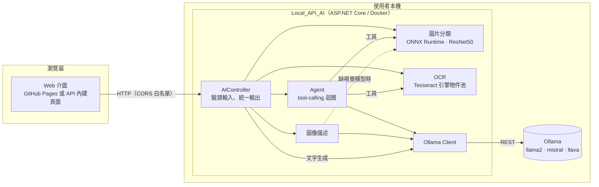
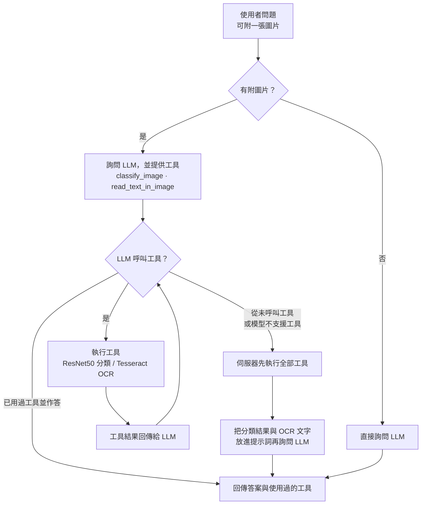
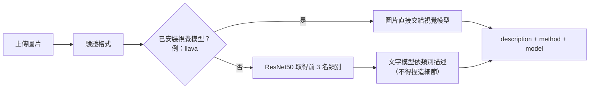
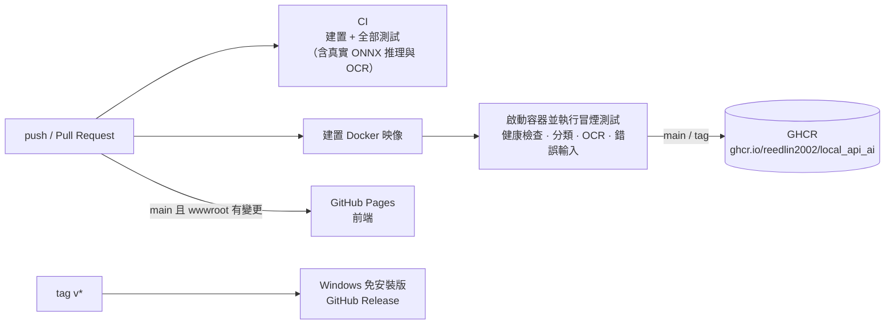

# Local_API_AI

### 本機部署的多模態 AI 推理 API

[](https://github.com/reedlin2002/Local_API_AI/actions/workflows/ci.yml)
[](https://github.com/reedlin2002/Local_API_AI/actions/workflows/container.yml)
[](https://reedlin2002.github.io/Local_API_AI/)

Local_API_AI 是一套在自己電腦上執行的 AI 推理服務，把圖片分類、OCR 文字辨識、文字生成、圖像描述，以及能自行呼叫工具的 Agent 整合成同一組 REST API。所有推理都在本機完成，資料不會上傳到任何雲端服務。

> **線上展示**：[開啟 Web Demo](https://reedlin2002.github.io/Local_API_AI/)
> 介面放在 GitHub Pages，AI 運算在你本機的 API 上執行。開啟頁面前請先用 Docker 啟動 API（見[快速開始](#快速開始)）。

> **專案定位**
> 本專案以通用預訓練模型（ImageNet ResNet50、Tesseract、Ollama 本機 LLM）為核心，重點在驗證「本機推理 + 工具呼叫 + 自動化交付」這條完整路線，而不是追求單一模型的極致準確度。


---

## 目錄

- [核心價值](#核心價值)
- [功能總覽](#功能總覽)
- [系統架構](#系統架構)
- [流程架構圖](#流程架構圖)
- [技術棧](#技術棧)
- [模型與方法](#模型與方法)
- [API 入口](#api-入口)
- [效能與品質改善](#效能與品質改善)
- [CI/CD](#cicd)
- [快速開始](#快速開始)
- [目前限制](#目前限制)
- [未來展望](#未來展望)
- [專案結構](#專案結構)

---

## 核心價值

- **資料不離開本機**：影像與文字只在本機處理，適合內部文件、敏感圖片與離線環境。
- **一組 API 整合多種能力**：分類、OCR、文字生成、圖像描述與 Agent 共用相同的上傳、錯誤與輸出格式。
- **Agent 一定看過圖才回答**：模型會用 tool calling 呼叫 OCR 與分類；小模型沒有呼叫工具時，伺服器會先跑工具，再把結果交給模型，避免憑空作答。
- **缺模型時優雅降級**：沒有視覺模型時，圖像描述改用分類結果；Ollama 沒啟動時回傳清楚的 503 提示，而不是一般的伺服器錯誤。
- **預設安全**：CORS 只允許指定網站、錯誤訊息不帶堆疊資訊、不記錄使用者的 prompt 與模型輸出、限制上傳大小。
- **自動化交付**：每次 push 都會跑測試、建置並實際啟動 Docker 映像做冒煙測試，通過後才發佈。

## 功能總覽

| 功能 | 說明 |
| --- | --- |
| 圖片分類 | ResNet50 辨識圖片主體，回傳前 5 名 ImageNet 類別與機率 |
| 批次分類 | 一次上傳多張圖片，無法解析的檔案會單獨標示錯誤 |
| OCR 文字辨識 | 辨識圖片中的英文與繁體中文 |
| 文字生成 | 透過本機 Ollama 文字模型回答與創作 |
| 圖像描述 | 有視覺模型時直接看圖描述；沒有時以分類結果請文字模型描述，並在回應中標明使用的方法 |
| 智慧問答 Agent | 可附一張圖片，Agent 自行決定要呼叫 OCR 或圖片分類，再回答問題 |
| 多格式輸出 | 每個端點都能回傳 JSON 或純文字 |

---

## 系統架構



### 前端

`wwwroot/index.html` 是純靜態頁面，同一份檔案有兩種用法：由 API 本身提供（`http://localhost:5136`），或部署在 GitHub Pages 上，再連回使用者本機的 API。頁面會自動偵測 API 是否在線，並可自訂 API 位址。

### 後端與 AI 推理

ASP.NET Core（.NET 10）提供 REST API，負責：

- 驗證上傳檔案（格式、大小）並統一錯誤回應格式（RFC 7807）
- 圖片分類與 OCR 直接在程序內執行，模型只在啟動時載入一次
- 文字生成、圖像描述與 Agent 透過 Ollama REST API 呼叫本機 LLM
- 將 Ollama 的各種失敗（未啟動、缺模型、不支援工具、逾時）轉成明確的狀態碼與提示

### 外部服務

唯一的外部依賴是本機的 [Ollama](https://ollama.com)，只有文字生成、圖像描述與 Agent 需要它；圖片分類與 OCR 不需要網路，也不需要 Ollama。

---

## 流程架構圖

### Agent 決策流程



### 圖像描述流程



### 錯誤處理

| 情境 | 狀態碼 | 回應 |
| --- | --- | --- |
| 上傳的不是圖片 | `400` | 說明支援的格式 |
| 缺少必要欄位或未知的 model | `400` | 指出缺少哪個欄位 |
| Ollama 沒有啟動 / 缺少模型 | `503` | 提示執行 `ollama serve` 或 `ollama pull <模型>` |
| 模型在時限內未回應 | `504` | 可調整 `Ollama:TimeoutSeconds` |
| 未預期錯誤 | `500` | 只回傳通用訊息，細節留在伺服器日誌 |

---

## 技術棧

| 分層 | 技術 |
| --- | --- |
| API | ASP.NET Core（.NET 10）、Swagger / OpenAPI、ProblemDetails |
| 圖片分類 | ONNX Runtime、ResNet50 v2、SkiaSharp（解碼、EXIF 轉正、縮放裁切） |
| OCR | Tesseract 5（英文 + 繁體中文） |
| LLM | Ollama（文字、tool calling、視覺模型） |
| 前端 | HTML、CSS、JavaScript（無框架） |
| 測試 | xUnit、WebApplicationFactory（真實模型整合測試 + 假 Ollama 單元測試） |
| 部署 | Docker（GHCR）、GitHub Pages、Windows 免安裝版（GitHub Releases） |
| CI/CD | GitHub Actions |

---

## 模型與方法

| 模組 | 模型／方法 | 主要用途 |
| --- | --- | --- |
| 影像前處理 | 短邊縮放至 256 → 中央裁切 224 → ImageNet mean/std 正規化 | 與 ResNet50 訓練時的輸入一致 |
| 圖片分類 | ResNet50 v2（ONNX Model Zoo）+ softmax | 1000 類 ImageNet 物件辨識，輸出機率 |
| OCR | Tesseract LSTM，`eng+chi_tra`；中文字間多餘空白自動移除 | 擷取圖片中的文字 |
| 文字生成 | Ollama `llama2`（可設定） | 問答與創作 |
| Agent | Ollama `mistral`（支援 tool calling，可設定） | 判斷何時需要看圖、整合工具結果回答 |
| 圖像描述 | Ollama `llava`（可設定）；缺少時退回分類結果 + 文字模型 | 產生圖片的自然語言描述 |

---

## API 入口

| 方法 | 路徑 | 用途 |
| --- | --- | --- |
| `GET` | `/health` | 服務健康檢查 |
| `POST` | `/api/ai` | 通用入口：`model` = `imageclassifier`、`textgeneration`、`agent` |
| `POST` | `/api/ai/batch-classify` | 批次圖片分類 |
| `POST` | `/api/ai/ocr` | OCR 文字辨識 |
| `POST` | `/api/ai/describe-image` | 圖像描述 |
| `POST` | `/api/ai/ask` | Agent 問答（可附圖片） |

所有 `POST` 端點接受 `multipart/form-data`，並以 `?outputFormat=json|text` 選擇輸出格式。完整參數與回應格式請啟動服務後查看 `/swagger`。

---

## 效能與品質改善

以下為本次重構前後的實測結果（伺服器端處理時間）：

| 項目 | 改善前 | 改善後 | 原因 |
| --- | --- | --- | --- |
| 圖片分類 | 約 620 ms | 約 45 ms | 100 MB 模型改為啟動時載入一次，而不是每個請求重新載入 |
| OCR | 780–1200 ms | 約 55 ms | Tesseract 引擎改用物件池重複使用 |
| 分類正確性 | 每個標籤都錯位一格 | 正確 | 標籤檔多了一行 `background`；現在啟動時會檢查標籤數與模型輸出一致 |
| 信心分數 | 原始 logit（例：10.4） | 機率（例：37%） | 加入 softmax，並回傳前 5 名 |
| Docker 映像大小 | 1.81 GB | 812 MB | 只發佈 linux-x64 的原生函式庫 |

---

## CI/CD



所有 workflow 只使用 GitHub 內建的 `GITHUB_TOKEN`，不需要在 repo 設定任何 secret。

---

## 快速開始

```bash
docker run --rm -p 127.0.0.1:5136:8080 ghcr.io/reedlin2002/local_api_ai:latest
```

啟動後開啟 http://localhost:5136 或 [線上 Web Demo](https://reedlin2002.github.io/Local_API_AI/) 即可使用。

- 文字生成、圖像描述與 Agent 需要另外安裝 [Ollama](https://ollama.com) 並下載模型（`llama2`、`mistral`，視覺描述可選 `llava`）。
- 不想用 Docker：可到 [Releases](https://github.com/reedlin2002/Local_API_AI/releases) 下載 Windows 免安裝版，或安裝 .NET 10 SDK 後在專案目錄執行 `dotnet run`。
- 模型名稱、Ollama 位址、允許的網站與上傳上限都在 `appsettings.json`，也可以用環境變數覆寫（例如 `Ollama__AgentModel=qwen2.5`）。

---

## 目前限制

- **分類只涵蓋 ImageNet 1000 類**：屬於通用物件辨識，相近類別容易混淆（例如 tiger cat 與 tabby cat），也無法辨識類別以外的內容。
- **中文 OCR 準確度有限**：Tesseract 對印刷體表現較好，手寫、低解析度或複雜背景容易出錯（例如「圖片」可能被辨識成「圖傅」）。
- **小型 LLM 的工具呼叫不穩定**：實測 `mistral` 7B 約六次中只有一次主動呼叫工具，因此由伺服器補跑工具來確保回答有依據。
- **未安裝視覺模型時的圖像描述**：只根據分類標籤推測，不是真的「看到」圖片，回應中會以 `method: label-fallback` 標明。
- **沒有身分驗證**：設計為本機使用，請勿直接對外開放；Docker 指令預設只綁定 `127.0.0.1`。
- **瀏覽器限制**：從 GitHub Pages 連回本機 API 時，Chrome / Edge 會詢問是否允許存取本機網路；Safari 會阻擋 https 頁面連到 `http://localhost`，建議改用 API 內建頁面。

---

## 未來展望

1. **預設改用視覺語言模型**：以 Qwen2.5-VL 等模型取代「分類 + 文字模型」的描述方式，讓 Agent 也能直接看圖。
2. **GPU 加速**：啟用 ONNX Runtime 的 CUDA / DirectML 執行環境，並提供 GPU 版 Docker 映像。
3. **串流回應**：LLM 回答改為逐字串流，降低長回答的等待感。
4. **擴充 Agent 工具**：加入文件解析、表格擷取等工具，並支援多張圖片。
5. **區網部署模式**：加入 API Key 驗證與使用量限制，讓團隊能在內網共用一台推理主機。
6. **模型管理**：模型檔改為首次啟動時下載並驗證雜湊，縮小 repo 體積並方便更換模型。

---

## 專案結構

```text
Local_API_AI/
├── Controllers/
│   └── AIController.cs            # API 路由、輸入驗證、輸出格式
├── Services/
│   ├── ImageClassifier.cs         # ONNX ResNet50 分類與影像前處理
│   ├── OcrService.cs              # Tesseract OCR（引擎物件池）
│   ├── OllamaClient.cs            # Ollama REST API 用戶端
│   ├── ImageDescriber.cs          # 圖像描述（視覺模型／分類降級）
│   └── AgentService.cs            # Agent tool-calling 迴圈
├── Infrastructure/                # 設定、例外與統一錯誤回應
├── Models/                        # ResNet50 ONNX 模型與 ImageNet 標籤
├── tessdata/                      # Tesseract 語言檔（eng、chi_tra）
├── wwwroot/                       # 前端頁面（同時部署到 GitHub Pages）
├── tests/LocalAIAgentAPI.Tests/   # 整合測試與單元測試
├── samples/                       # 測試用圖片
├── scripts/                       # Linux Tesseract 設定、冒煙測試
├── .github/workflows/             # CI、Docker、Pages、Release
├── Dockerfile
└── README.md
```

## 授權與模型來源

- 圖片分類模型：[ONNX Model Zoo – ResNet50 v2](https://github.com/onnx/models)
- OCR 語言檔：[tesseract-ocr/tessdata](https://github.com/tesseract-ocr/tessdata)
